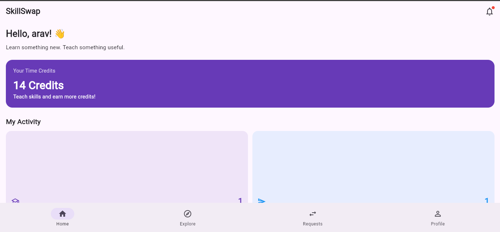
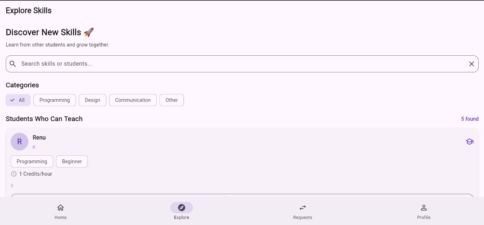

# SkillSwap

SkillSwap is a platform where college students can learn from each other by sharing their skills.

The idea is simple: if you know something, you can teach it to another student and earn credits. You can then use those credits to learn something new from someone else. This way, students can exchange knowledge without having to pay for every learning session.

**Live Demo:** https://skillswap-715cc.web.app

## Features

- **Create a Profile:** Students can sign up, log in and manage their profiles.
- **Share Your Skills:** Add the skills you can teach to other students.
- **Explore Skills:** Browse skills shared by other students and find something you want to learn.
- **Send Learning Requests:** Request sessions with students who offer the skills you're interested in.
- **Session Management:** Schedule sessions, track requests and check your session history.
- **Credit System:** Earn credits by teaching and use them to learn from others.
- **Session Confirmation:** Both students need to confirm that a session is completed before credits are transferred.
- **Notifications:** Stay updated about learning requests and session activities.
## App Screenshots

### Home Screen



### Explore Skills


## Tech Stack

- Flutter & Dart
- Firebase Authentication
- Cloud Firestore
- Provider (State Management)
- SharedPreferences
- Firebase Hosting

## Run Locally

To run SkillSwap on your system:

1. Clone the repository:

   ```bash
   git clone https://github.com/Renubtcse/SkillSwap.git
   ```

2. Open the project folder:

   ```bash
   cd SkillSwap
   ```

3. Install the dependencies:

   ```bash
   flutter pub get
   ```

4. Configure Firebase for your own project.

5. Run the app:

   ```bash
   flutter run
   ```

## About the Project

I built SkillSwap to make peer learning easier and encourage students to share what they know. It brings skill discovery, learning requests and a credit-based exchange system together in one place.

**Built by:** Renu Sharma

**GitHub:** https://github.com/Renubtcse
